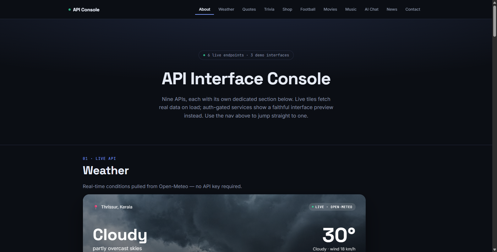
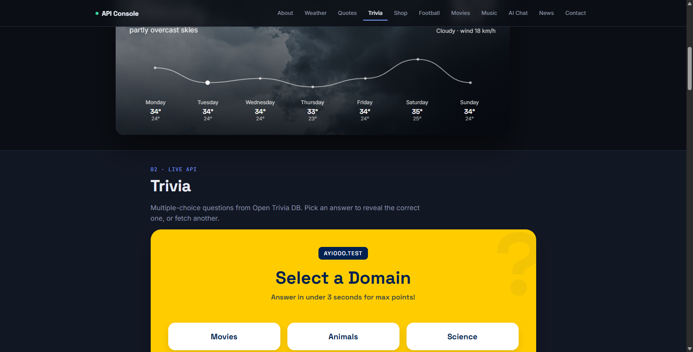

# 🌐 API Interface Console — Live Data Dashboard

<div align="center">

[](https://react.dev/)
[](https://vitejs.dev/)
[](https://developer.mozilla.org/en-US/docs/Web/JavaScript)
[](LICENSE)

A clean, responsive React dashboard showcasing 9 different real-world APIs with live data feeds (Weather, Trivia, Quotes, Movies, Sports, and AI).

<br/>



</div>

---

## 📸 Previews

| API Console Dashboard | Live Trivia & Interactive Modules |
| :---: | :---: |
|  |  |
| **Real-Time Weather & Live Feeds** | **Interactive Open Trivia DB Module** |

---

## ✨ Features

- 🌤️ **Live Weather Forecast**: Real-time meteorological telemetry and weekly temperature graphs from Open-Meteo.
- 🎯 **Interactive Trivia Arena**: Multiple-choice trivia questions pulled live from Open Trivia DB.
- 📜 **Inspirational Quotes & News**: Dynamic quote generation and curated developer headlines.
- 🛍️ **E-Commerce & Storefront API**: Product catalog simulation with shopping cart state.
- ⚡ **Zero Auth Needed**: Integrates public, no-key-required endpoints for immediate out-of-the-box demonstration.

---

## 🚀 How to Run

1. **Install Dependencies**:
   ```bash
   npm install
   ```
2. **Start Dev Server**:
   ```bash
   npm run dev
   ```
   Then open [`http://localhost:4444/api-showcase/`](http://localhost:4444/api-showcase/) in your browser.
3. **Build for Production**:
   ```bash
   npm run build
   ```

---

## 📄 License

MIT License © 2026 [Sooraj Studio](https://github.com/soorajstudio)
